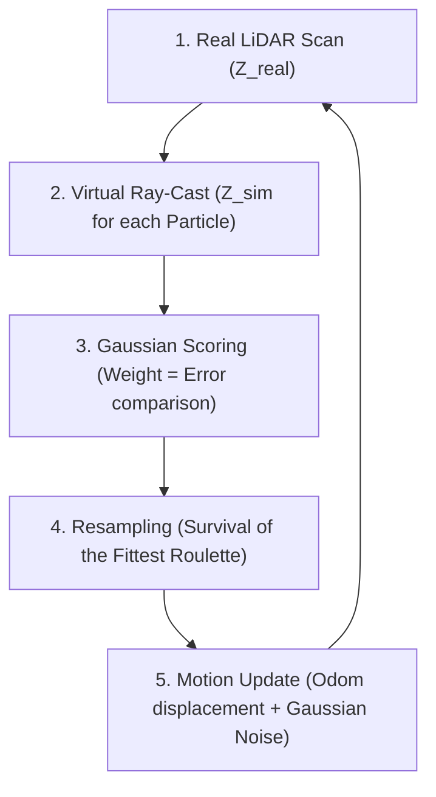

# Lesson: Demystifying AMCL & The Particle Filter

## 1. Overview & Intuition: Two Parallel Realities

The **Adaptive Monte Carlo Localization (AMCL)** algorithm tracks a mobile robot's position by maintaining two parallel worlds at the exact same time inside computer memory:

```
┌───────────────────────────────────────────┐      ┌───────────────────────────────────────────┐
│          REAL WORLD (Physical)            │      │       DIGITAL WORLD (Inside ROS RAM)      │
├───────────────────────────────────────────┤      ├───────────────────────────────────────────┤
│ • 1 Physical AMR chassis                  │      │ • 200–2,000 Virtual "Ghost" Robots        │
│ • Physical 2D LiDAR raycaster             │      │ • Pre-saved 2D Occupancy Grid Map         │
│ • Real walls, concrete pillars, shelves   │      │ • Mathematical Ray-Casting against pixels │
└─────────────────────┬─────────────────────┘      └─────────────────────┬─────────────────────┘
                      │                                                  │
                      │ Real Laser Distances (Z_real)                    │ Virtual Raycasts (Z_sim)
                      └─────────────────────────┬────────────────────────┘
                                                │
                                                ▼
                                    Gaussian Weight Comparison
                                                │
                                                ▼
                                    Update TF: [map -> odom]
```

Every "ghost robot" is called a **Particle**. A particle represents a specific hypothesis: *"I bet the real robot is right here at $(x, y, \theta)$."*

---

## 2. Anatomy of a Particle (Under the Hood)

In code, a particle is not a 3D model; it is literally just a plain C++ data structure:

```cpp
struct Particle {
    double x;      // Guessed X coordinate in the map (meters)
    double y;      // Guessed Y coordinate in the map (meters)
    double theta;  // Guessed heading angle (radians)
    double weight; // Confidence score between 0.0 and 1.0
};
```

AMCL's particle cloud is simply an array of these structures: `std::vector<Particle> particle_cloud;`.

---

## 3. The 4-Step AMCL Continuous Loop



---

## 4. Concrete Walkthrough with 3 Laser Beams

To see the exact math in action, let's step through an isolated test case.

### A. The Setup
* **Environment:** A square room of size **$10\text{ m} \times 10\text{ m}$**.
  * South wall: $y = 0$, North wall: $y = 10$, West wall: $x = 0$, East wall: $x = 10$.
* **3 Laser Beams:**
  1. `Beam 1` (Front / Center): $0^\circ$ relative to heading.
  2. `Beam 2` (Left): $+90^\circ$ relative to heading.
  3. `Beam 3` (Right): $-90^\circ$ relative to heading.

### B. Step 1: Real World Measurement
The physical AMR is at:
$$\mathbf{P}_{\text{real}} = (x = 5.0\text{ m},\ y = 2.0\text{ m},\ \theta = 90^\circ \text{ [facing North / +Y]})$$

The real LiDAR bounces light off physical walls:
* **Front Beam $\rightarrow$ North wall ($y=10$):** $10.0 - 2.0 = \mathbf{8.0\text{ m}}$
* **Left Beam $\rightarrow$ West wall ($x=0$):** $5.0 - 0.0 = \mathbf{5.0\text{ m}}$
* **Right Beam $\rightarrow$ East wall ($x=10$):** $10.0 - 5.0 = \mathbf{5.0\text{ m}}$

$$\mathbf{Z}_{\text{real}} = [8.0\text{ m},\ 5.0\text{ m},\ 5.0\text{ m}]$$

---

### C. Step 2: Digital World (Two Competing Particles)

```
        North Wall (y = 10)
┌─────────────────────────────────┐
│                                 │
│         [Particle B]            │  <-- Bad guess: (x=2.0, y=7.0, θ=90°)
│                                 │
│                                 │
│        [Particle A]             │  <-- Good guess: (x=5.1, y=2.0, θ=90°)
│         [Real AMR]              │      (Real AMR is at x=5.0, y=2.0)
└─────────────────────────────────┘
        South Wall (y = 0)
```

Each particle casts virtual rays on the digital grid map:

#### 1. Particle A (Close to reality): $(x = 5.1,\ y = 2.0,\ \theta = 90^\circ)$
* Front $\rightarrow$ North ($y=10$): $10.0 - 2.0 = \mathbf{8.0\text{ m}}$
* Left $\rightarrow$ West ($x=0$): $5.1 - 0.0 = \mathbf{5.1\text{ m}}$
* Right $\rightarrow$ East ($x=10$): $10.0 - 5.1 = \mathbf{4.9\text{ m}}$
$$\mathbf{Z}_{\text{sim}}^{(A)} = [8.0\text{ m},\ 5.1\text{ m},\ 4.9\text{ m}]$$

#### 2. Particle B (Far away): $(x = 2.0,\ y = 7.0,\ \theta = 90^\circ)$
* Front $\rightarrow$ North ($y=10$): $10.0 - 7.0 = \mathbf{3.0\text{ m}}$
* Left $\rightarrow$ West ($x=0$): $2.0 - 0.0 = \mathbf{2.0\text{ m}}$
* Right $\rightarrow$ East ($x=10$): $10.0 - 2.0 = \mathbf{8.0\text{ m}}$
$$\mathbf{Z}_{\text{sim}}^{(B)} = [3.0\text{ m},\ 2.0\text{ m},\ 8.0\text{ m}]$$

---

### D. Step 3: Weight Calculation (Gaussian Likelihood Math)

For each beam $j$, calculate the discrepancy $e_j = |z_{\text{real}, j} - z_{\text{sim}, j}|$.
Then convert that error into probability with a Gaussian distribution ($\sigma = 0.2\text{ m}$ sensor tolerance):

$$p(e_j) = \exp\left(-\frac{e_j^2}{2\sigma^2}\right), \quad \text{Weight } W = \prod_{j=1}^{3} p(e_j)$$

#### Scoring Particle A:
* Beam 1: $|8.0 - 8.0| = 0.0\text{ m} \implies \exp(0) = \mathbf{1.0}$
* Beam 2: $|5.0 - 5.1| = 0.1\text{ m} \implies \exp(-0.125) \approx \mathbf{0.88}$
* Beam 3: $|5.0 - 4.9| = 0.1\text{ m} \implies \exp(-0.125) \approx \mathbf{0.88}$
$$\mathbf{W}_A = 1.0 \times 0.88 \times 0.88 \approx \mathbf{0.774} \quad \text{(High Confidence!)}$$

#### Scoring Particle B:
* Beam 1: $|8.0 - 3.0| = 5.0\text{ m} \implies \exp(-312.5) \approx \mathbf{10^{-136}}$
* Beam 2: $|5.0 - 2.0| = 3.0\text{ m} \implies \exp(-112.5) \approx \mathbf{10^{-49}}$
* Beam 3: $|5.0 - 8.0| = 3.0\text{ m} \implies \exp(-112.5) \approx \mathbf{10^{-49}}$
$$\mathbf{W}_B \approx \mathbf{0.00000000000...} \quad \text{(Effectively Dead)}$$

---

### E. Step 4: Resampling & Motion Update

1. **Survival of the Fittest:** Normalized weights act as slices on a roulette wheel. Particle A gets chosen dozens of times and duplicated into new clone particles. Particle B gets 0 picks and is garbage-collected.
2. **Motion + Noise Injection:** The AMR wheels roll forward $0.5\text{ m}$. All surviving clones move forward $0.5\text{ m}$ plus random Gaussian noise ($\pm 2\text{ cm}$, $\pm 1^\circ$).
   * *Why add noise?* Without noise, all particles collapse into a single point and can never recover if wheel slip occurs later.

---

## 5. How AMCL Connects Back to the TF Tree

Once all particles converge:
1. AMCL takes the **weighted average** of the surviving particle cluster:
   $$\mathbf{P}_{\text{estimate}} = (\bar{x}, \bar{y}, \bar{\theta})$$
2. It compares this against current wheel odometry (`odom -> base_link`).
3. It publishes the difference to TF as the dynamic link:
   $$\mathbf{[map \rightarrow odom]}$$
4. This corrects global drift without ever interrupting the smooth wheel odometry running the motors.
