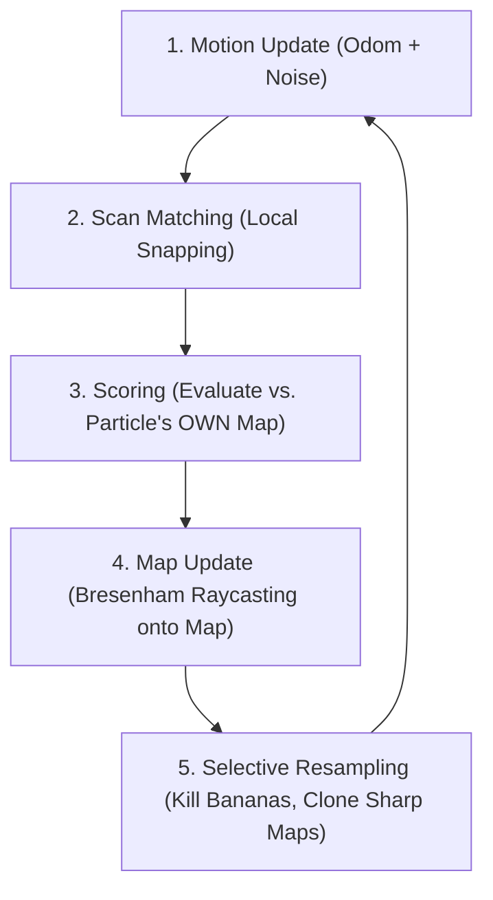

# Lesson: 2D LiDAR SLAM & Gmapping (The Rao-Blackwellized Particle Filter)

## 1. Overview & Intuition: The Chicken-and-Egg Problem

In **AMCL**, the robot has a pre-loaded map and only needs to answer: *"Where am I on this map?"*

In **SLAM (Simultaneous Localization And Mapping)**, there is **NO map**. The robot is dropped into an unknown room with nothing but wheel encoders and a LiDAR.

This creates the classic robotics paradox:
> **To build a map**, you must know where the robot is.  
> **To know where the robot is**, you must already have a map.

```
       ┌────────────────────────────────────────────────────────┐
       │                 THE SLAM CHICKEN-AND-EGG               │
       ├────────────────────────────────────────────────────────┤
       │   Know Robot Pose  ────────►  Draw Correct Map         │
       │          ▲                            │                │
       │          │                            │                │
       │   Match against Map ◄────────  Have a Map              │
       └────────────────────────────────────────────────────────┘
```

### The Anchor: Solving Step 0
Since there is no map and no GPS, the robot takes a bold shortcut:
> **"Wherever I am standing at this exact second, I define as coordinate $(x=0, y=0, \theta=0^\circ)$."**

The first LiDAR scan is 100% trusted. It establishes the universe origin and draws the very first walls of the digital map.

---

## 2. Key Terminology Glossary

Before looking at code and loops, let's establish exact definitions for core terms:

### 1. Particle (Cartographer)
* In AMCL, a particle is just a pose guess $(x, y, \theta)$.
* In **SLAM (FastSLAM / Gmapping)**, each particle is an **independent cartographer**. It holds **its own pose guess AND its own private copy of the entire 2D map** in computer RAM.

### 2. Occupancy Grid Map
A 2D array of grid cells (like graph paper, e.g., $5\text{cm} \times 5\text{cm}$ per cell). Each cell stores an occupancy probability:
* **Gray / Unknown (`?` / -1 / 50%):** Virgin territory. No laser beam has ever reached this cell.
* **White / Free Air (`.` / 0%):** Clear space. Light passed through without hitting anything.
* **Black / Occupied (`█` / 100%):** Solid obstacle or wall where the beam bounced back.

### 3. Calculated Hit Point
The real LiDAR only outputs a raw angle and a distance (e.g., $30^\circ$, $4.2\text{m}$).  
The **Calculated Hit Point** is where that laser bounce would physically land in global world coordinates $(x_{\text{hit}}, y_{\text{hit}})$, based on a specific particle's guessed pose $(x_p, y_p, \theta_p)$:
$$x_{\text{hit}} = x_p + d \cdot \cos(\theta_p + \alpha)$$
$$y_{\text{hit}} = y_p + d \cdot \sin(\theta_p + \alpha)$$
*(where $d$ is measured distance, $\alpha$ is beam angle relative to robot).*

### 4. Raycasting (Bresenham’s Line Algorithm)
A computer graphics algorithm used to trace a straight line of pixels on a grid from the robot $(x_p, y_p)$ to the hit point $(x_{\text{hit}}, y_{\text{hit}})$.  
* All cells along the line are carved out as **Free Space (White)**.
* The final cell at the end of the line is marked as **Occupied (Black)**.

### 5. Verification vs. Violation vs. Exploration
How a particle grades a laser beam:
* **Verification (Hit lands on Black):** Laser confirms a wall already mapped $\rightarrow$ **Weight++**.
* **Violation (Hit lands on White or passes through Black):** Physically impossible ghost wall $\rightarrow$ **Weight crashes**.
* **Exploration (Hit lands on Gray):** Discovering new territory $\rightarrow$ **Neutral score (No penalty)**.

### 6. Odometry Drift & "Banana Walls"
Tiny errors in wheel radius, tire compression, or floor slip accumulate over time. If a robot drifts $0.5^\circ$ every meter, a 50m straight hallway will be mapped as a curved **"banana"** if odometry is trusted blindly.

### 7. Loop Closure
When a robot drives in a long circle and returns to a room it mapped earlier. Particles that accumulated drift will misalign with the old walls and get destroyed. The particle whose noise canceled out the drift will snap onto the old walls, instantly straightening the whole map.

---

## 3. Anatomy of a Particle: AMCL vs. SLAM

Look at the radical difference in computer memory:

### AMCL Particle (Cheap):
```cpp
struct AMCLParticle {
    double x, y, theta; // Just 24 bytes of RAM!
    double weight;
};
// 2,000 particles share ONE global static map.
```

### SLAM Particle (Heavy):
```cpp
struct SLAMParticle {
    double x, y, theta;       // Pose hypothesis
    OccupancyGrid my_own_map;  // 💥 A COMPLETE INDEPENDENT 2D GRID MAP!
    double weight;            // Consistency score
};
// 30 particles = 30 separate maps running simultaneously in RAM!
```

> **Why so few particles in SLAM?**  
> While AMCL runs 500 to 2,000 particles, Gmapping only runs **30 to 80 particles**. If you ran 2,000 full maps in RAM, your computer would instantly run out of memory and freeze.

---

## 4. The 5-Step SLAM Continuous Loop



1. **Motion (Predict):** Wheels move; particles disperse due to random noise.
2. **Scan Matching:** Each particle slightly adjusts its pose to "snap" new laser hits onto walls it previously drew.
3. **Scoring:** Beams hitting existing walls (Black) increase weight; beams hitting empty air (White) decrease weight; beams hitting unexplored space (Gray) are ignored.
4. **Map Update:** Surviving particles carve new free space and paint new walls into their private maps.
5. **Resampling:** If particle diversity drops too low, bad mapmakers are pruned, and good ones are duplicated.

---

## 5. Concrete Walkthrough with a 3-Laser AMR

Let's walk through an exact numerical example on a **1-meter grid world** with integer coordinates $(x, y)$.

### The Robot Setup
* The AMR has **3 LiDAR beams**:
  * `Beam 1` (Left, $+90^\circ$)
  * `Beam 2` (Center, $0^\circ$)
  * `Beam 3` (Right, $-90^\circ$)

---

### Step 0: Initial Scan at Origin ($t = 0$)

The robot starts at **$(x=0, y=0, \theta=0^\circ)$**. The entire map in RAM is **`?` (Gray / Unknown)**.

The LiDAR fires:
* **Beam 1 (Left, $+90^\circ$):** returns **$3\text{m}$** $\rightarrow$ Hit point: $(0, 3)$
* **Beam 2 (Center, $0^\circ$):** returns **$5\text{m}$** $\rightarrow$ Hit point: $(5, 0)$
* **Beam 3 (Right, $-90^\circ$):** returns **$3\text{m}$** $\rightarrow$ Hit point: $(0, -3)$

#### Raycasting on the blank grid:
* **Beam 2 path:** $(1,0), (2,0), (3,0), (4,0)$ $\rightarrow$ turn **`.` (White / Free Air)**.
* **Beam 2 end:** $(5,0)$ $\rightarrow$ turns **`█` (Black / Wall)**.
* **Beams 1 & 3:** Air cells turn **`.`**; hit cells $(0,3)$ and $(0,-3)$ turn **`█`**.

```
y
▲
3    █ (Wall)
2    . (Air)
1    . (Air)
0   [ROBOT (0,0)] ── . ── . ── . ── . ──► █ (Wall at 5,0)
-1   . (Air)
-2   . (Air)
-3   █ (Wall)
     0            1    2    3    4    5 ────► x
    (All other cells everywhere are "?" Gray / Unknown)
```
Both **Particle A** and **Particle B** start with this exact map in RAM.

---

### Step 1: Robot Moves Forward ($t = 1$)

* The physical robot drives **2 meters forward** along $+X$.
* **Real physical AMR pose:** $(x=2, y=0, \theta=0^\circ)$.

Odometry reports: *"Moved forward 2 meters."*  
Simulated particle noise kicks in:
* **Particle A (Accurate Cartographer):** Guesses pose is **$(x=2, y=0, \theta=0^\circ)$**.
* **Particle B (Drifted Cartographer):** Wrongly assumes wheels slipped 1m; guesses pose is **$(x=1, y=0, \theta=0^\circ)$**.

---

### Step 2: Second Scan Arrives

At real position $(2,0)$, the physical LiDAR fires:
* **Beam 2 (Center):** Hits front wall at 5m $\rightarrow$ returns **$3\text{m}$** ($5 - 2 = 3\text{m}$).
* **Beam 1 (Left):** Hits continuous side wall $\rightarrow$ returns **$3\text{m}$**.
* **Beam 3 (Right):** There is an open doorway! Beam travels deep into a new room $\rightarrow$ returns **$8\text{m}$**.

---

### Step 3: Scoring & Weighting (The Core Referee)

Before drawing, each particle tests this scan against **what it drew at Step 0**:

#### Evaluating Particle A (Pose: $x=2, y=0$):
1. **Beam 2 (Center, $3\text{m}$):**
   * Calculated hit: $x = 2 + 3 = 5 \rightarrow (5,0)$.
   * Cell $(5,0)$ in Particle A's map is **`█` (Black / Wall)**.
   * **Verification!** Laser hit confirms a previously drawn wall $\rightarrow$ **Score: +10**.
2. **Beam 1 (Left, $3\text{m}$):**
   * Calculated hit: $(2, 3)$.
   * Cell $(2,3)$ in map is **`?` (Gray / Unknown)**.
   * **Exploration!** New territory, no penalty $\rightarrow$ **Score: Neutral (0)**.
3. **Beam 3 (Right, $8\text{m}$):**
   * Calculated hit: $(2, -8)$.
   * Cell $(2,-8)$ in map is **`?` (Gray / Unknown)**.
   * **Exploration!** New territory, no penalty $\rightarrow$ **Score: Neutral (0)**.

> **Particle A Total Weight:** $\mathbf{0.999}$ (Consistent and reliable).

---

#### Evaluating Particle B (Pose: $x=1, y=0$ — Drift Error):
1. **Beam 2 (Center, $3\text{m}$):**
   * Calculated hit: $x = 1 + 3 = 4 \rightarrow (4,0)$.
   * Particle B looks up cell $(4,0)$ in its map: **It is `.` (White / Empty Air)!**
   * **Violation!** Light bounced off empty space where light previously passed freely. Ghost wall detected! $\rightarrow$ **Score: -100**.
2. **Beams 1 & 3:** Land in `?` (Gray) $\rightarrow$ Neutral.

> **Particle B Total Weight:** $\mathbf{0.00001}$ (Severe physical contradiction).

---

### Step 4: Map Update (Raycasting New Territory)

Particle A won the round. It now uses Bresenham raycasting to expand its map:
* **Beam 2 (Center):** Reinforces existing wall at $(5,0)$.
* **Beam 1 (Left):**
  * Cells $(2,1)$ and $(2,2)$ turn from **`?` (Gray)** to **`.` (White Air)**.
  * Cell $(2,3)$ turns from **`?` (Gray)** to **`█` (New Wall)**.
* **Beam 3 (Right):**
  * All 7 cells from $(2,-1)$ to $(2,-7)$ turn from **`?` (Gray)** to **`.` (White Air / Open Doorway)**.
  * Cell $(2,-8)$ turns from **`?` (Gray)** to **`█` (New Wall deep in room)**.

---

### Step 5: Pruning & Loop Closure

* **Particle B** (Weight = `0.00001`) is pruned and deleted from RAM.
* **Particle A** (Weight = `0.999`) is cloned.
* When the robot eventually completes a loop and returns to $(0,0)$, particles that drifted produce ghost walls and die, while particles that kept straight lines survive. The global map snaps into a razor-sharp final layout.

---

## 6. Summary Comparison: AMCL vs. Gmapping (SLAM)

| Feature | AMCL | Gmapping (SLAM) |
|---|---|---|
| **Map Availability** | Preloaded `.yaml` / `.pgm` | None (Created from scratch in RAM) |
| **Number of Particles** | 500 – 2,000 | 30 – 80 |
| **What a Particle Holds** | Just pose $(x, y, \theta)$ | Pose $(x, y, \theta)$ **+ Entire 2D Occupancy Grid Map** |
| **RAM Usage** | Very light (~few Kilobytes) | Heavy (~hundreds of Megabytes) |
| **Start State ($t=0$)** | Particles scattered across building | All particles stacked at origin $(0,0,0^\circ)$ |
| **Scoring Basis** | Single global static map | Each particle's **own private map** |
| **Role of Gray Cells** | Not applicable | Allows exploration without penalizing particles |
| **Drift Defense** | Corrects `map -> odom` transform | Loop closure kills "banana" maps and snaps loop shut |
